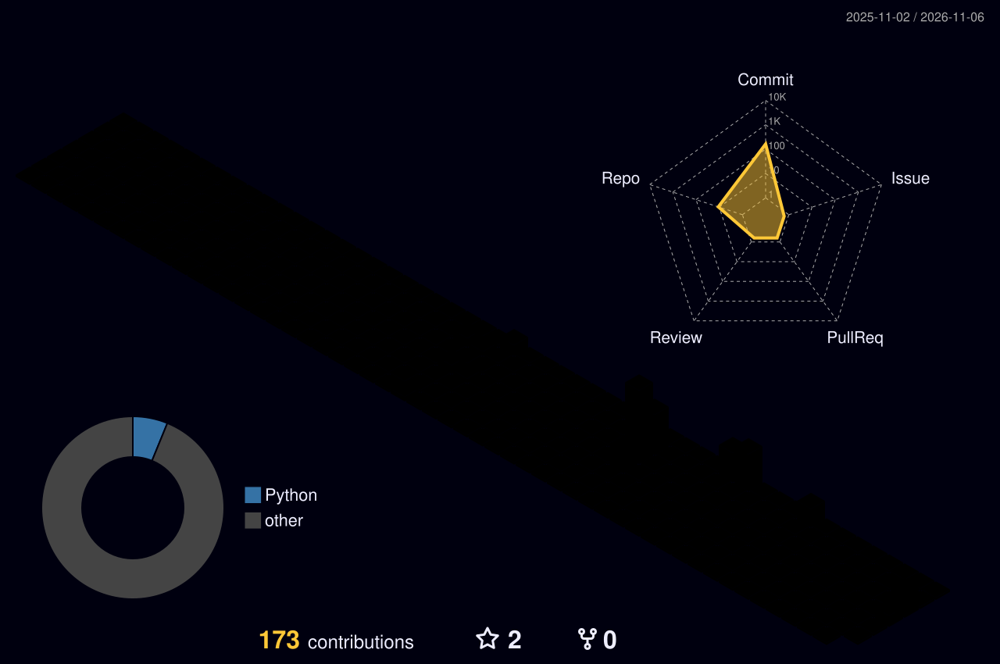
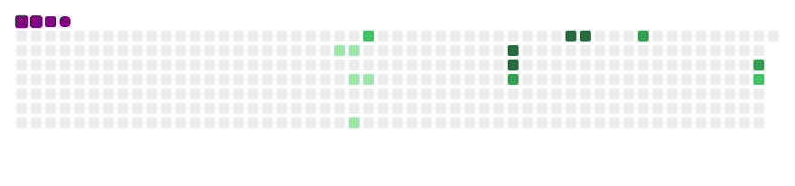

# Hi 👋, I'm Chhavi Agrawal

### 💻 B.Tech Computer Science Student | Aspiring Data Analyst

I'm a Computer Science student at **GLA University, Mathura**, passionate about Data Analytics, Technology, and Software Development.

I enjoy learning new technologies, solving problems, and building projects that turn data into meaningful insights.

### 🚀 About Me

* 🎓 Pursuing B.Tech in Computer Science.
* 📊 Interested in Data Analytics & Business Intelligence.
* 💻 Learning Python, SQL and JavaScript.
* ☁️ Exploring Cloud Computing and AWS.
* 🌱 Always learning and improving my technical skills.

### 🛠️ Technical Skills

* **Programming:** Python, Java, JavaScript
* **Data Analytics:** Excel, SQl
* **Web Development:** HTML, CSS
* **Cloud:** AWS
* **Tools:** Git, GitHub, VS Code

### 🎯 Current Goals

* Improving my programming skills.
* Building Data Analytics projects.
* Learning new technologies.
* Preparing for software and data analyst opportunities.

### 🤝 Let's Connect

* LinkedIn: https://www.linkedin.com/in/chhavi-agrawal-612644326/
* GitHub: [ichhavi15](https://github.com/ichhavi15)

### 🌈 My 3D Contribution Graph

### 🐍 My GitHub Contribution Snake

### ✨ What I'm Learning

### 📊 GitHub Statistics

### 💻 Most Used Languages

---

⭐ *Thanks for visiting my profile!*
